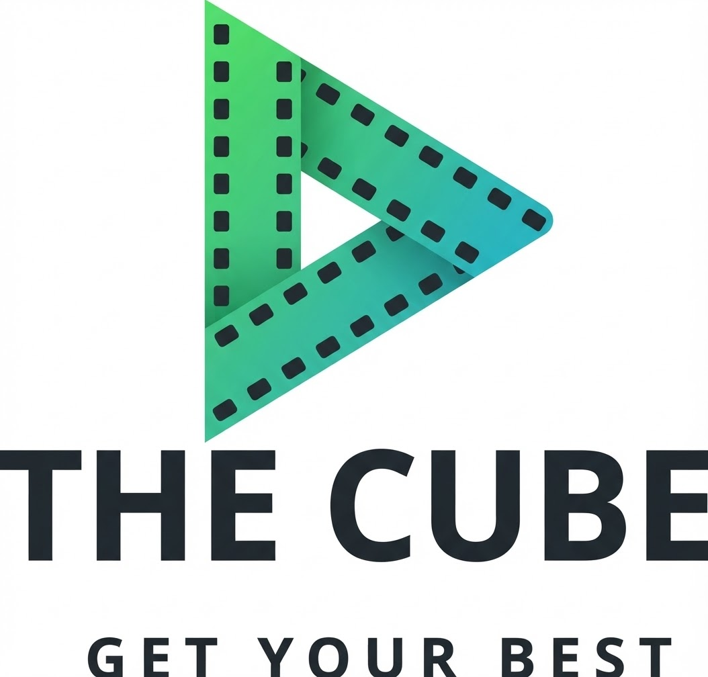
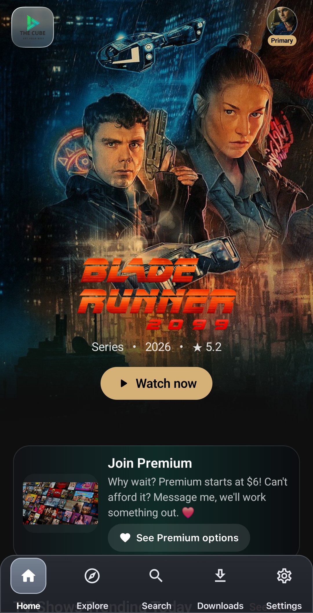
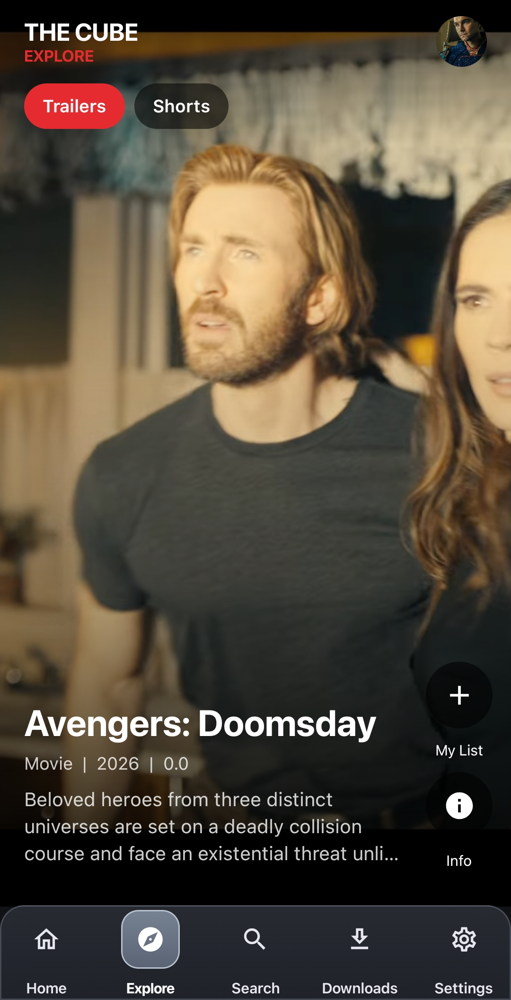
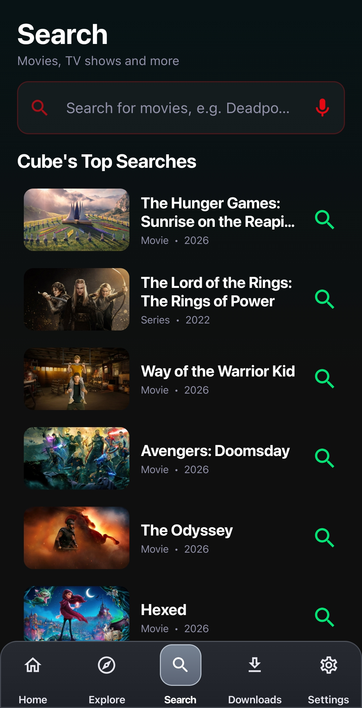
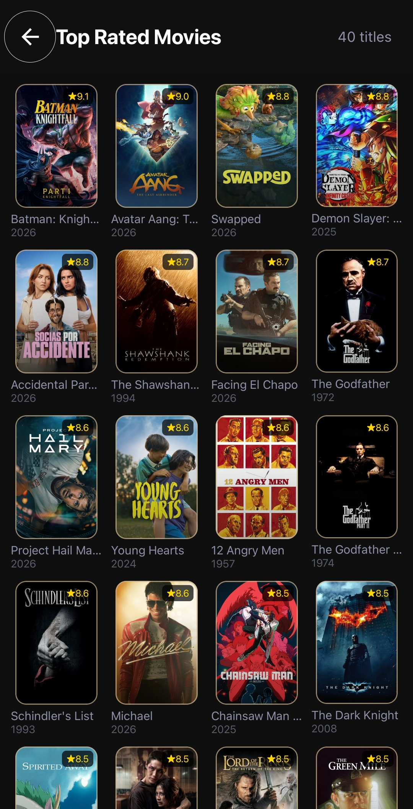
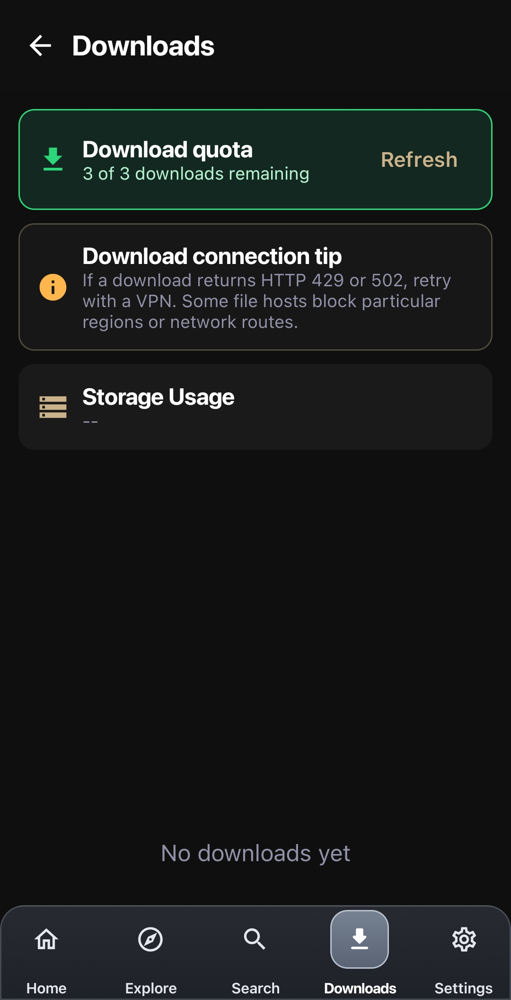
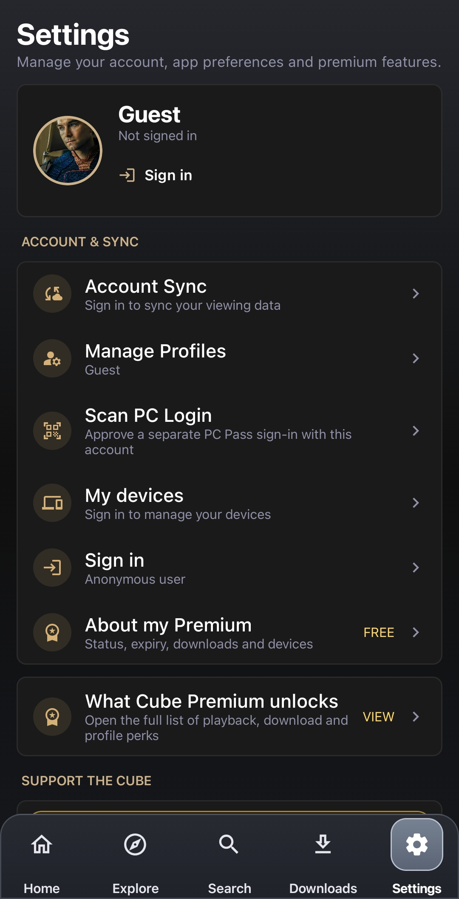

  

<h1 align="center">✨ THE CUBE ✨</h1>

<b>Your Entertainment. Your Screen. Your Experience.</b>

---

## 🍿 Something Worth Exploring

Some things are better experienced than explained.

**THE CUBE** is one of them. ❤️

Built with passion, designed with care, and constantly improving.

Whether you're on your Android phone, Android TV, desktop, or browser, there's something special waiting for you — with no subscriptions and no required account.

**Don't just take our word for it. Download the app and discover the gem for yourself. 💎**

### ✨ Highlights

* **Multi-platform support:** One APK for Android phones and Android TV (plus a dedicated **CubeTV** option), native builds for Windows and Linux, and a browser version at [thecub4.vercel.app](https://thecub4.vercel.app/).
* **Discovery & catalog:** Browse trending movies and TV shows, resume watching with *Continue Watching*, explore *Popular for Kids*, and filter by genres, channels, or studios.
* **Player & offline downloads:** Fullscreen video player, subtitle selection via OpenSubtitles, customizable playback/subtitle settings, and offline downloads.
* **Companion app:** Check out **Cubic Music** for music streaming from the same developer.

### 🖼️ Screenshots

| Home | Explore |
| Home | Explore |
| :---: | :---: |
|  |  |

| Search | Top Rated Movies |
| :---: | :---: |
|  |  |

| Downloads | Settings |
| :---: | :---: |
|  |  |

### 🚀 Get The Cube

📱 **Android & Android TV**

👉 **[Download The Latest Version](https://github.com/cybruGhost/cube/releases/latest)**

💻 **Desktop & Web**

🌐 **[Visit Our Website](https://thecub.netlify.app/)**

▶️ **[Stream in Browser (No Install)](https://thecub4.vercel.app/)**

### 📺 Fire TV, Fire Stick & Android TV

Installing through the **Downloader** app?

Simply enter:

# `3085564`

And you're ready to go!

---

## ❤️ Made With Passion

THE CUBE is an independently developed project, built for people who appreciate a great entertainment experience.

It's constantly evolving, with new improvements, refinements, and features along the way.

Your feedback helps make it even better.

---

## 🐛 Feedback & Suggestions

Found something that could be better?

Feel free to [open an issue](https://github.com/cybruGhost/cube/issues).

Your ideas, suggestions, and feedback are always welcome.

---

## 📜 License

Licensed under the GNU General Public License v3.0.
See [LICENSE](LICENSE) for details.

---

  <b>Made with ❤️ by <a href="https://github.com/cybruGhost">CyberGhost</a></b>

  <i>THE CUBE — Experience it for yourself. 🍿</i>

